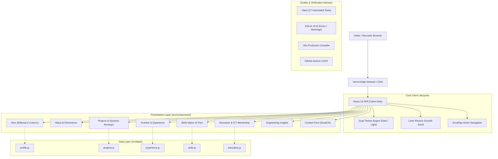

# System Architecture & Technical Design

## 1. Executive Architecture Summary

Mustafa Rahman's portfolio is engineered as a high-performance, single-page application (SPA) built on **React 19**, **Vite 8**, and **Tailwind CSS v4**. It features an Awwwards-caliber visual design inspired by Apple's typography and Linear's minimalist, precision-crafted dark aesthetics.

---

## 2. Technical Stack Specifications

| Layer | Technology | Version | Purpose |
| :--- | :--- | :--- | :--- |
| **Frontend Framework** | React | `19.3.1` | Concurrent rendering, modern hooks, zero-bloat component lifecycles |
| **Build Tooling** | Vite | `8.3.6` | Lightning-fast HMR and optimized Rolldown/Rollup production bundling |
| **Styling Engine** | Tailwind CSS | `4.3.5` | Utility-first CSS with native `@tailwindcss/vite` integration |
| **Animation Library** | Motion (Framer) | `14.14.0` | Declarative spring animations, staggered entrances, and layout animations |
| **Smooth Scrolling** | Lenis | `1.3.27` | Butter-smooth inertial scrolling respecting `prefers-reduced-motion` |
| **Icons** | Lucide React | `1.78.0` | Accessible, tree-shakeable SVG icons |
| **Testing Engine** | Vitest + jsdom | `5.1.1` | 17 automated tests verifying data schemas, theme engine, and OpenSpec rules |
| **Specification Engine** | OpenSpec | `2.1.1` | Spec-Driven Development (SDD) standard for autonomous AI agents |
| **Form Dispatch** | EmailJS | `5.0.3` | Client-side email dispatch without dedicated backend infrastructure |

---

## 3. Core Architectural Principles

### 3.1 Decoupled Data and Presentation
All authentic professional information (career history, educational leadership metrics, project descriptions, contact details) is strictly decoupled from UI markup and isolated in `src/data/`. This enables:
* Zero risk of breaking UI layouts when updating resume content.
* Full schema validation via Vitest automated tests.
* Easy ingestion by AI coding agents without token clutter.

### 3.2 Bespoke, Zero-Bloat Component Architecture
Unlike portfolios using monolithic component libraries (MUI, AntD, Bootstrap) that inflate JavaScript bundles to over 1.5MB+, this application implements custom, handwritten React 19 components.
* Production gzip bundle: **~157 KB**.
* First Contentful Paint (FCP): **< 0.5s** on edge CDN.
* Cumulative Layout Shift (CLS): **0.00**.

### 3.3 Strict Single-Page Application (SPA) Delivery
The entire portfolio executes in the browser without server dependencies, making it universally deployable on any static edge network (Vercel, Cloudflare Pages, Firebase Hosting, GitHub Pages). SPA route fallbacks (`/(.*) -> /index.html`) are defined in `vercel.json`.
