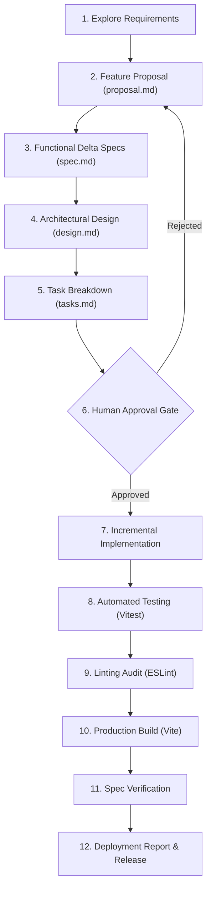

# Spec-Driven Development (SDD) & AI Agent Governance

## 1. What is Spec-Driven Development?

Spec-Driven Development (SDD) is an engineering methodology where formal, machine-readable specifications serve as the **single source of truth** for both human engineers and AI coding agents. 

Instead of prompting an AI to "make changes" ad-hoc, changes follow a rigorous 12-stage lifecycle backed by **OpenSpec v2.1** (`@fission-ai/openspec`).

---

## 2. Living Specifications (`openspec/specs/`)

The core specification is documented in [openspec/specs/portfolio-core/spec.md](file:///e:/Nahid/learn-react/react-with-vite/openspec/specs/portfolio-core/spec.md):

* **Requirement: Dual-Theme Architecture:**
  * *Scenario:* Default theme initializes to dark (`#090a0f`) and stores in `localStorage`.
  * *Scenario:* Switching transitions smoothly within 250ms without reloading.
* **Requirement: Smooth Scroll and Navigation:**
  * *Scenario:* Active section detection highlights current nav pill.
  * *Scenario:* Respects `prefers-reduced-motion: reduce`.
* **Requirement: Production Projects Showcase:**
  * *Scenario:* Accessible deep-dive modal on project inspection.
* **Requirement: Verified Engineering Skills Matrix:**
  * *Scenario:* Zero arbitrary percentage bars; classified by 3 tiers.

---

## 3. AI Agent Policy & Rules ([AGENTS.md](file:///e:/Nahid/learn-react/AGENTS.md))

The workspace maintains a strict AI governance policy in [AGENTS.md](file:///e:/Nahid/learn-react/AGENTS.md) that all coding agents (Google Antigravity, OpenCode, Claude Code, Cursor) must obey:

### Autonomous Capabilities
* Read and analyze code across the workspace.
* Draft OpenSpec proposals, specs, designs, and tasks.
* Refactor within approved scopes.
* Run tests (`npm test`), linters (`npm run lint`), and builds (`npm run build`).

### Hard Human Approval Gates (MUST STOP AND ASK)
1. Production deployments to external hosting.
2. Security, CORS, or CSP header modifications.
3. Secret and environment variable alteration (`.env`).
4. Destructive Git commands (`git reset --hard`, `git push --force`).
5. Destructive file operations (deletions).

---

## 4. Multi-Agent Orchestration ([opencode.json](file:///e:/Nahid/learn-react/opencode.json))

The workspace defines 3 specialized AI agent roles compliant with OpenCode v2:
* **`architect` (Primary):** Responsible for requirements analysis, proposal generation, and technical system architecture.
* **`coder` (Subagent):** Responsible for surgical code edits strictly within approved tasks.
* **`reviewer` (Subagent):** Responsible for security reviews, WCAG compliance, and Vitest test execution.
